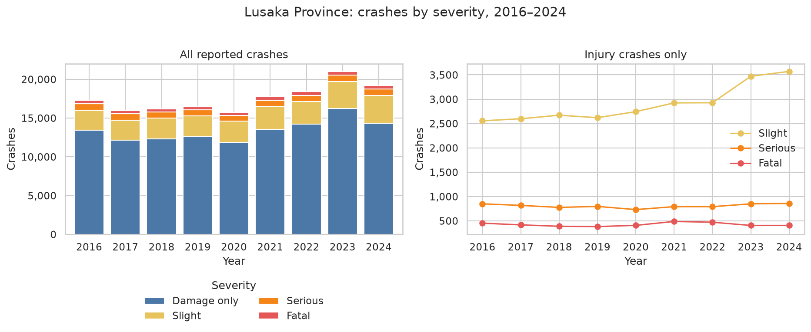
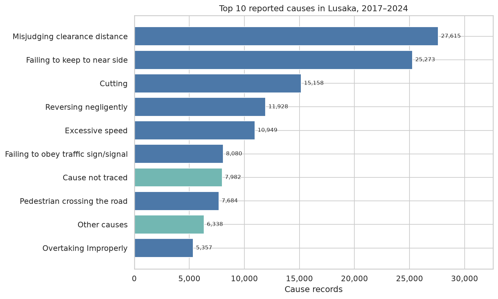
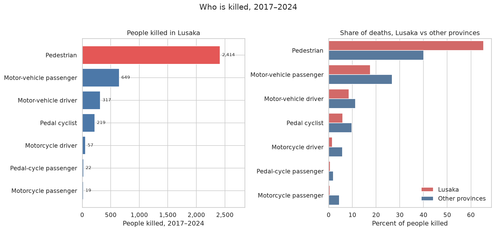

# Lusaka road safety, 2016–2024

A beginner portfolio project by **Dennis Kabaso**, a computer science student in Lusaka who is learning to work as a data analyst.

The project is one Jupyter notebook. It loads public crash tables, cleans the labels, and answers plain questions with pandas and matplotlib/seaborn charts. The style follows a first pandas project: one question, one table, one chart.

The tables are yearly and quarterly totals for Zambia, not one row per crash. Unless a question says otherwise, the place is Lusaka Province (`province == "LUSAKA"` after the names are standardised).

## Questions

1. How many crashes did Lusaka record from 2016 to 2024, and how serious were they?
2. Which quarter is busiest, and how do urban and rural crashes compare?
3. What are the top 10 reported causes, and which of them changed the most?
4. Which days and time slots have the most crashes?
5. Who is killed most often, which vehicles are involved, and how does Lusaka compare with other provinces?
6. Optional: how many crashes does Zambia record per 100,000 people?

## Key findings

These figures are printed by the executed notebook in `notebooks/lusaka_road_safety_analysis.ipynb`.

From 2016 to 2024, Lusaka Province recorded **157,962** reported crashes. **120,791 (76.5%)** were damage only, **26,082 (16.5%)** slight, **7,267 (4.6%)** serious, and **3,822 (2.4%)** fatal. The busiest year was **2023 (20,970)** and the quietest was **2020 (15,740)**. Fatal crashes peaked in **2021 (488)**, which is not the year with the most crashes.

Lusaka accounted for **54.3%** of crashes reported in Zambia (157,962 of 290,837) and **25.9%** of fatal crashes (3,822 of 14,743). Most of Lusaka's extra volume is damage-only crashes.



In 2017–2024 (table x2 has no 2016 rows), **Q3** was the busiest quarter with **36,497** crashes, only **45** ahead of Q4 (36,452). The leading quarter changes by year. Over those same years, **126,685** Lusaka crashes were urban (**90.1%**) and **13,960** were rural (**9.9%**). The urban share in the notebook runs from **88.3%** in 2020 to **92.5%** in 2024.

The most common reported cause in Lusaka was **misjudging clearance distance** (27,615 records, 19.5% of cause records), then **failing to keep to near side** (25,273) and **cutting** (15,158). Those three are **48.0%** of Lusaka cause records. The top 10 also includes **cause not traced** (7,982) and **other causes** (6,338), which are not specific acts.

From 2017 to 2024, **failing to obey traffic sign/signal** rose from **3.4%** of Lusaka cause records to **12.1%** (540 to 2,328). **Cutting** fell from **13.4%** to **7.6%** (2,133 to 1,465).



**Friday** had the most Lusaka crashes (22,589), **63** ahead of Saturday (22,526). Sunday had the fewest (17,962). The busiest time slot was **18:00–20:00** (20,069) and the quietest was **23:59–07:00** (13,697). Day and time tables do not split crashes by severity, so a busy slot is a slot with more reported crashes.

Of **3,697** people killed in Lusaka from 2017 to 2024, **2,414** were pedestrians (**65.3%**). In the other nine provinces, pedestrians were **40.1%** of 12,145 deaths. Lusaka was **23.3%** of people killed nationally (3,697 of 15,855), well below its 54.3% share of all crashes. KKIA, the airport division, adds 13 deaths and is kept out of the other-province share.

Putting the two tables side by side for 2017–2024 gives **1.10** deaths per fatal crash in Lusaka (3,697 deaths / 3,370 fatal crashes) and **1.25** in the other provinces. Copperbelt is highest at **1.49**. These are separate counts, so the ratio is a comparison.

**Private cars and vans** were 145,366 of 207,397 vehicles involved in Lusaka crashes (**70.1%**), against **46.6%** in the other provinces. Taxis and contract vehicles were **1.1%** in Lusaka and **8.4%** elsewhere. A vehicle row is a vehicle involved, so the total is higher than the number of crashes, and 2016 is not in this table.



Nationally, reported crashes per 100,000 people were highest in **2016 (191.26)** and lowest in **2020 (149.45)**, 21.9% lower. The 2024 rate was **167.63**. Crash totals come from table x1. Population is the series published with the dataset, and the recomputed rates match that file. The table is saved at `outputs/derived_indicators.csv`.

## How to run

Python 3.12 was used to execute the notebook. Create a virtual environment, install the pinned libraries, and open the notebook:

```bash
python -m venv .venv
source .venv/bin/activate
pip install -r requirements.txt
jupyter notebook notebooks/lusaka_road_safety_analysis.ipynb
```

The notebook finds the project folder from its working directory, so it can be started from the repository root or from `notebooks/`. Charts are written to `images/` and the national rate table to `outputs/derived_indicators.csv`.

The copy in this repository is already executed, so the tables and charts are visible without re-running it. To refresh the outputs:

```bash
jupyter nbconvert --to notebook --execute notebooks/lusaka_road_safety_analysis.ipynb --inplace
```

## Data

**Zambia Road Safety Data (2016–2024): National Road Traffic Accidents, Casualties, Causes, and Vehicle Types.** Moses Mwale, Chuncky Kanchele, and Kelvin Mwangilwa. Zenodo, 4 May 2026. DOI: [10.5281/zenodo.20022372](https://doi.org/10.5281/zenodo.20022372).

Licensed under [Creative Commons Attribution 4.0 International (CC BY 4.0)](https://creativecommons.org/licenses/by/4.0/). The dataset licence and the citation file shipped in the archive are in `data/LICENSE.txt` and `data/CITATION.cff`. The Zenodo record names all three authors; the archive's `CITATION.cff` names Moses Mwale.

This repository keeps a single copy of the tables the notebook reads:

| File | Used for |
| --- | --- |
| `data/raw/x1_annual_rta_reported.csv` | Crashes by year, province, and severity |
| `data/raw/x2_total_no_rt_cs_by_quarter.csv` | Quarter, and urban or rural |
| `data/raw/x10_causes_of_accidents.csv` | Reported cause |
| `data/raw/x11_day_of_accidents.csv` | Day of the week |
| `data/raw/x12_times_of_accidents.csv` | Time slot (the column is named `day`) |
| `data/raw/x6_class_of_persons_kille.csv` | People killed, by road-user class |
| `data/raw/x9_types_of_motor_vehicles.csv` | Vehicles involved |
| `data/raw/published_derived_indicators.csv` | Population series published with the dataset |

The CSV files are the originals. The notebook standardises labels in memory: province spellings such as `Lusaka` / `LUSAKA` and `C/BELT` / `Copperbelt`, severity case such as `FATAL` / `fatal`, and a few cause typos. It drops empty Excel pivot columns. It does not overwrite the source files.

## Limitations

- Each row is a published total. The notebook cannot describe a junction, an age, or a single crash.
- Table x1 covers 2016–2024. The quarter, cause, day, time, death, and vehicle tables start in 2017, so those answers leave 2016 out.
- KKIA, the airport division, is reported only in 2018–2020 in the annual table. It is not added to Lusaka Province. It accounts for 13 deaths in the years it appears.
- The blank cells in the raw files are leftover pivot columns. In the cause table, 22.16% of cells are blank before those columns are dropped and 0% after. The count fields then have no missing values. 24.6% of cause rows are stored as zero, and those zeros are kept.
- Lusaka's quarterly totals match its annual totals in every shared year. Eastern Province in 2018 does not: the quarterly table sums to 1,671 and the annual table to 1,472, a gap of 199. That gap is left as published.
- Lusaka cause records match the annual crash total in most years. They do not in 2018 (16,187 cause records versus 16,176 crashes) or 2021 (18,801 versus 17,774). The 2021 gap is mostly "heavy rain", recorded as 825 crashes that year against 9 in 2020 and 12 in 2022. The top 10 does not depend on that row, and the row is not deleted.
- People killed and fatal crashes come from different tables. The deaths-per-fatal-crash figure only sets those two totals next to each other.
- Population is the authors' published series, not a new census extract. A change in the rate can be a change in crashes, in population, or in how completely crashes were reported. Under-reporting is a standing limit of administrative crash data.

## Licence

The analysis code in this repository is [MIT](LICENSE), copyright Dennis Kabaso. The road-safety dataset is not covered by that MIT licence. It remains CC BY 4.0, as above, and should be cited when the tables or the derived rates are reused.
